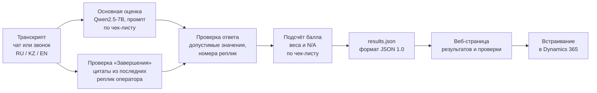

# DatatonDoomsday — автоматическая оценка качества чатов поддержки

Система проверяет работу операторов службы поддержки брокера по **чек-листу качества чатов Freedom Broker**. На вход она получает транскрипт чата или звонка на русском, казахском или английском. На выходе по каждому из 8 критериев выдаёт оценку, короткое обоснование на русском и номера реплик, которые её подтверждают, а также итоговый балл от 0 до 100 и флаг грубой ошибки.

Оценку выполняет **локальная языковая модель Qwen2.5-7B-Instruct**. Она работает на компьютере команды через Ollama, поэтому транскрипты клиентов никуда не отправляются, и за оценку не нужно платить по API.

---

## Зачем это нужно

Ручной контроль качества чатов медленный и субъективный: проверяющий читает диалог целиком, вспоминает правила чек-листа, считает баллы с учётом неприменимых критериев. Система делает то же самое за секунды на диалог, всегда по одним и тем же правилам, и показывает, **почему** выставлена каждая оценка: обоснование и номера реплик-доказательств. Решение остаётся проверяемым: любую оценку можно открыть, сверить с текстом диалога и исправить.

## Как это работает



1. **Основная оценка.** Модель получает транскрипт с пронумерованными репликами (клиент, бот, оператор, системные события) и промпт на русском. Промпт построен на официальной формулировке чек-листа, к каждому критерию добавлено пошаговое правило решения: например, когда ставить N/A, а когда «Нет». Модель отвечает по жёсткой JSON-схеме: Ollama ограничивает генерацию, поэтому ответ всегда имеет правильную структуру. Сначала модель пишет обоснование, затем выбирает значение.
2. **Отдельная проверка «Завершения».** На этом критерии модель в общем промпте ошибалась чаще всего: принимала простое «Хорошего дня!» за итог разговора. Поэтому завершение проверяется вторым, коротким запросом. Модель должна дословно процитировать итог, предложение помощи и прощание, а код проверяет, что цитаты действительно есть в репликах оператора. Обрыв связи распознаётся по системным сообщениям.
3. **Проверка ответа.** Каждое значение сверяется с допустимыми для критерия (например, для консультации только 0/5/10/15/20/N/A). Номера реплик вне диалога отбрасываются. При некорректном ответе модель вызывается повторно.
4. **Подсчёт балла.** Балл считает код, а не модель, строго по порядку расчёта из чек-листа: «Да» даёт полный вес, шкалы пересчитываются пропорционально, N/A исключается с перераспределением веса, итог округляется до двух знаков. Грубая ошибка отмечается отдельным флагом и балл не обнуляет.
5. **Результат** записывается в `results/<dev|prod>/results.json` в формате организаторов. Каждый диалог получает ровно одну запись. Если диалог не удалось оценить, он сохраняется со `status: "error"` и причиной, а не скрывается и не получает ноль.

На один диалог приходится два вызова модели, и оба выполняются локально.

## Критерии и подсчёт балла

| № | Критерий | Код | Значения | Вес |
|---|---|---|---|---:|
| 01 | Установление контакта | `contact` | Да / Нет | 10 |
| 02 | Выявление потребности | `discovery` | Да / Нет / N/A | 15 |
| 03 | Идентификация | `identification` | Да / Нет / N/A | 20 |
| 04 | Корректная и полная консультация | `consultation` | 0, 5, 10, 15, 20 / N/A | 20 |
| 05 | Эмпатия и клиентоориентированность | `empathy` | Да / Нет | 15 |
| 06 | Управление диалогом, скорость и грамотность | `dialogue` | 0, 4, 7, 10 | 15 |
| 07 | Завершение | `closure` | Да / Нет / N/A | 5 |
| 08 | Грубые ошибки | `critical` | Да / Нет (флаг, без баллов) | — |

`итоговый балл = 100 × набранные баллы / сумма весов применимых критериев`

Пример из приложения организаторов (контакт «Да», консультация 15, ведение диалога 7, потребность и идентификация N/A) даёт ровно **85.38**. Этот случай закреплён в тестах.

Порог первой реакции (3 минуты), теги и вложения по условиям задания не оцениваются.

## Формат результатов

Файл соответствует «Формату JSON 1.0» из приложения к гайду:

- `true` / `false` / `null` (N/A) и целые числа шкал — настоящие значения JSON, а не строки;
- `evidence_turns` нумеруются с 1 по всему транскрипту, включая клиента, бота и системные события;
- `critical_flag` совпадает со значением `critical`;
- ID диалогов совпадают с ответом API организаторов символ в символ;
- файл в UTF-8 без BOM.

Встроенный валидатор (`python run.py validate`) проверяет всё это перед отправкой, а для контрольного набора — что записей ровно 10.

## Веб-интерфейс

Локальная страница (`python run.py serve`, http://127.0.0.1:8000) на русском, со светлой и тёмной темой и мобильной вёрсткой.

- **«Результаты».**
  - Сводка по запуску: число диалогов, средний балл, диалоги с грубыми ошибками, доля «Да» по каждому критерию.
  - Список диалогов с баллом и цветными отметками по 8 критериям, фильтры по языку, грубым ошибкам и низкому баллу.
  - Карточка диалога: оценка и обоснование по каждому критерию рядом с текстом диалога. Нажатие на номер реплики прокручивает диалог к ней и подсвечивает её.
- **«Проверка».** Режим для специалиста по качеству.
  - Ответ модели можно подтвердить или исправить крупными кнопками «Да / Нет / N/A» или ступенями шкалы, с официальным описанием выбранной ступени.
  - Исправления сохраняются как эталонная разметка команды и не меняют `results.json`.

### Встраивание в Dynamics 365

Страница работает как HTML web resource на форме CRM:

- `/?embed=1` — компактный вид без верхней панели;
- `/?embed=1&id=<conversation_id>` — оценка одного диалога рядом с его текстом;
- `?data=id%3D…` — параметры в том виде, как их передаёт Dynamics 365;
- `postMessage({type: "cqa:open", conversationId})` — смена записи без перезагрузки.

Демонстрационный стенд с эмуляцией формы «Звонок» доступен по адресу `/d365`.

## Качество на DEV

Для измерения качества команда разметила все 65 диалогов DEV (60 чатов и 5 звонков) по строгому прочтению чек-листа. Это **наша** разметка, а не эталон организаторов. Совпадение ответов системы с ней для версии в репозитории:

| Метрика | Значение |
|---|---|
| Совпадение ответов по критериям | 76.7% |
| Средняя разница итогового балла | 14.0 балла из 100 |
| Грубые ошибки (критерий 08) | 98% |
| Идентификация | 91% |
| Эмпатия | 91% |
| Завершение | 85% |

Слабые места:

- «Установление контакта» — 71%: модель иногда не замечает, что оператор назвал своё имя;
- «Выявление потребности» — 40% и «Консультация» — 65%: эти критерии требуют самого тонкого понимания диалога.

Сравнение с разметкой: `python run.py compare results/dev/results.json labels/dev.json`.

## Ограничения

- Модель на 7B параметров ошибается в тонких случаях. Особенно это касается N/A в «Выявлении потребности», ступеней консультации и представления оператора в первой реплике. Все оценки сопровождаются обоснованием, чтобы их можно было проверить.
- Цифры качества измерены на тех же 65 диалогах, по которым настраивался промпт. На новых диалогах точность может быть ниже.
- Звонки оцениваются по тексту распознанной речи; ошибки распознавания могут влиять на оценку. Интонация и голос не оцениваются.
- Встраивание проверено на локальном эмуляторе формы. Для настоящего Dynamics 365, который работает по HTTPS, страницу нужно разместить по HTTPS-адресу, доступному из CRM.

## Дообучение (опционально)

В `training/` есть конвейер дообучения той же модели на размеченных диалогах. Он строит обучающие примеры с тем же промптом, что и при оценке, выполняет QLoRA-обучение на одной GPU от 12 ГБ и экспортирует результат в GGUF для Ollama. Команда `python run.py synth` генерирует синтетические диалоги RU/KZ/EN с заданными ошибками оператора, чтобы расширить обучающую выборку. Сравнение с базовой моделью проводится на отложенной части DEV.

## Технологии

- **Python 3.10+.** Для оценки нужна только стандартная библиотека, без сторонних пакетов.
- **Ollama + Qwen2.5-7B-Instruct.** Модель работает локально, ответ ограничивается JSON-схемой.
- **Веб-интерфейс** — один HTML-файл без фреймворков и внешних зависимостей.
- **Тесты** (`python -m unittest discover tests`) используют поддельный сервер модели. Они проверяют подсчёт балла, формат результатов, обработку ошибок и сбоев связи, разбор ответов модели, проверку «Завершения» и веб-API.

## Структура репозитория

```
run.py              командная строка: check, fetch, evaluate, validate, serve, compare, synth, build-sft
config.json         команда, модель, адрес Ollama, язык обоснований
cqa/checklist.py    формулировки чек-листа и правила принятия решения
cqa/prompt.py       промпт и JSON-схема ответа модели
cqa/closure.py      отдельная проверка «Завершения»
cqa/evaluate.py     оценка диалога: вызовы модели, проверка ответа, повторы
cqa/scoring.py      подсчёт итогового балла по чек-листу
cqa/results.py      запись и проверка results.json (формат 1.0)
cqa/runner.py       оценка набора: сохранение после каждого диалога, продолжение после сбоя
cqa/server.py       сервер веб-интерфейса
web/index.html      страница результатов и проверки
web/d365.html       эмулятор формы Dynamics 365
training/           дообучение QLoRA, экспорт в GGUF, Modelfile для Ollama
tests/              автоматические тесты
results/            dev/results.json и prod/results.json для организаторов
```

## Запуск

Windows PowerShell, из папки проекта:

```powershell
winget install Python.Python.3.12
winget install Ollama.Ollama
ollama pull qwen2.5:7b-instruct
python run.py check
```

`check` проверяет связь с моделью и показывает, работает ли она на GPU.

```powershell
python run.py fetch "<URL набора>" --out datasets/dev.json
python run.py evaluate datasets/dev.json --split dev
python run.py validate results/dev/results.json --data datasets/dev.json
python run.py serve
```

- Для контрольного набора используйте `--split prod`: в этом случае проверяется, что записей ровно 10.
- Если оценка прервалась, повторный запуск продолжит с места остановки, готовые диалоги не пересчитываются.
- Без реальных данных можно попробовать на вымышленных примерах: `python run.py evaluate datasets/sample.json --out runs/sample.json`.
